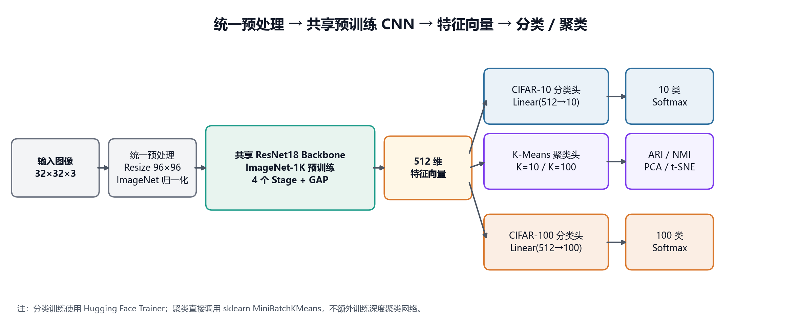
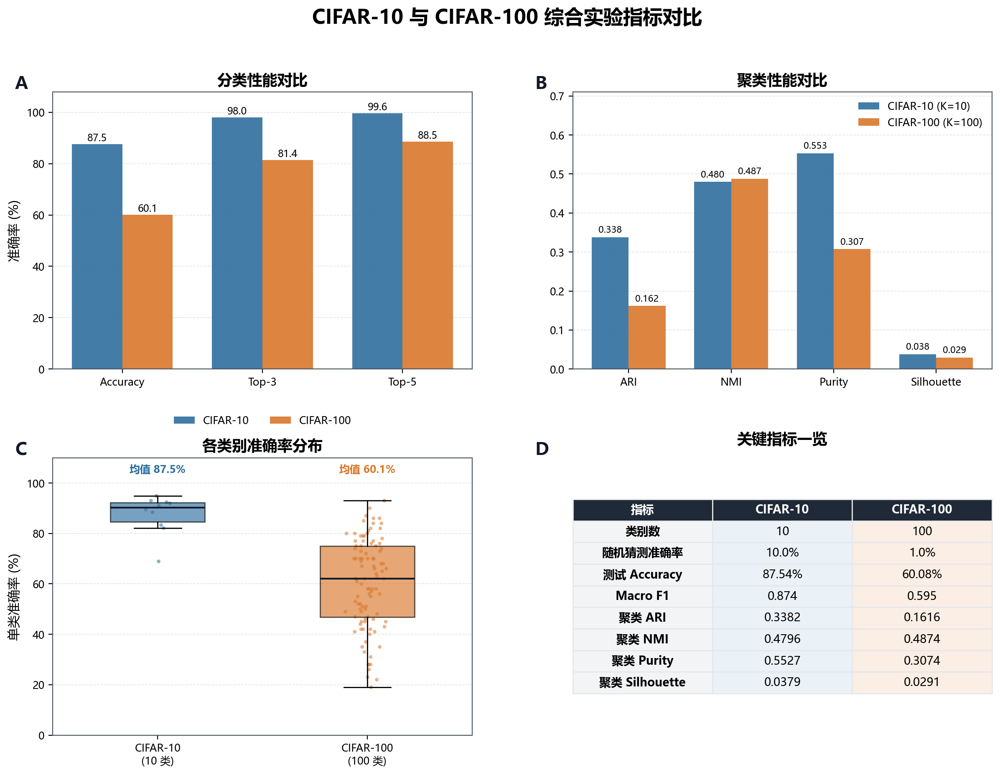
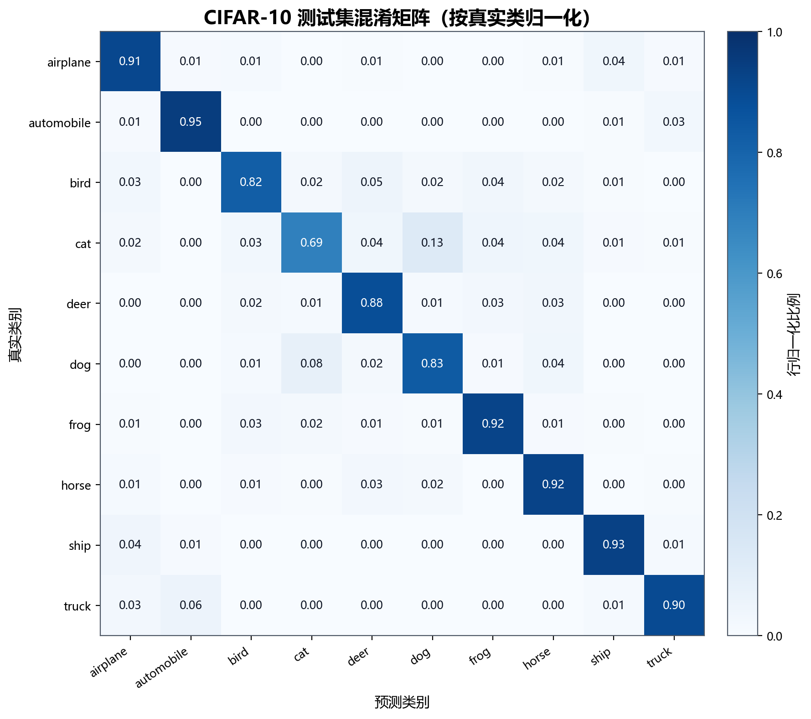
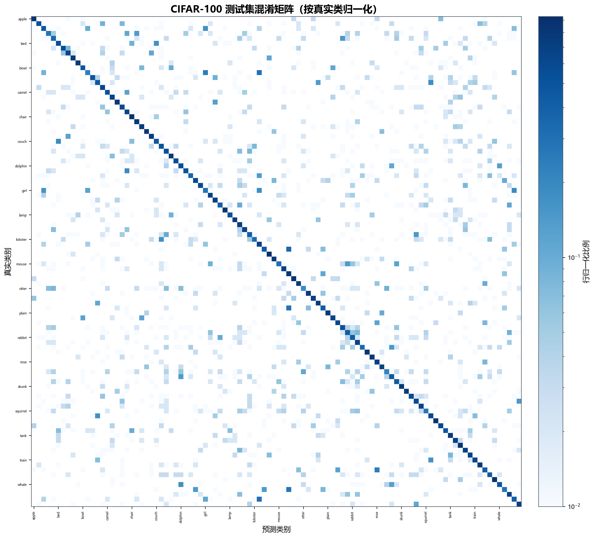
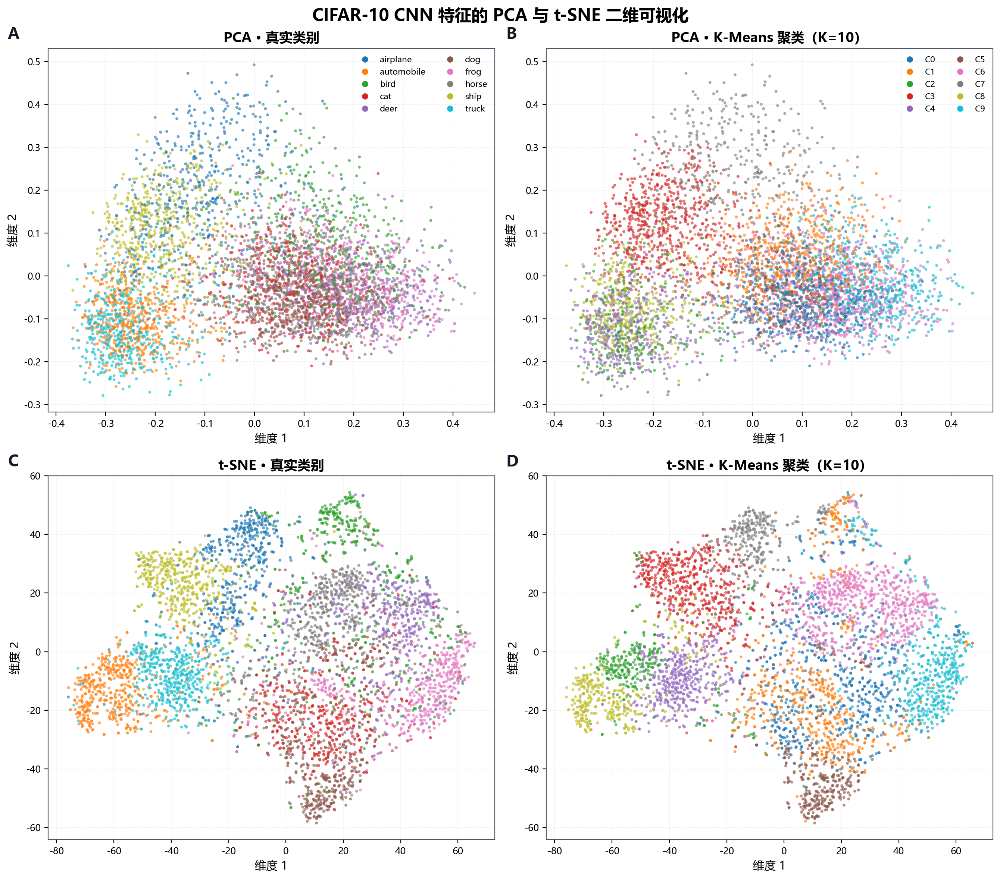
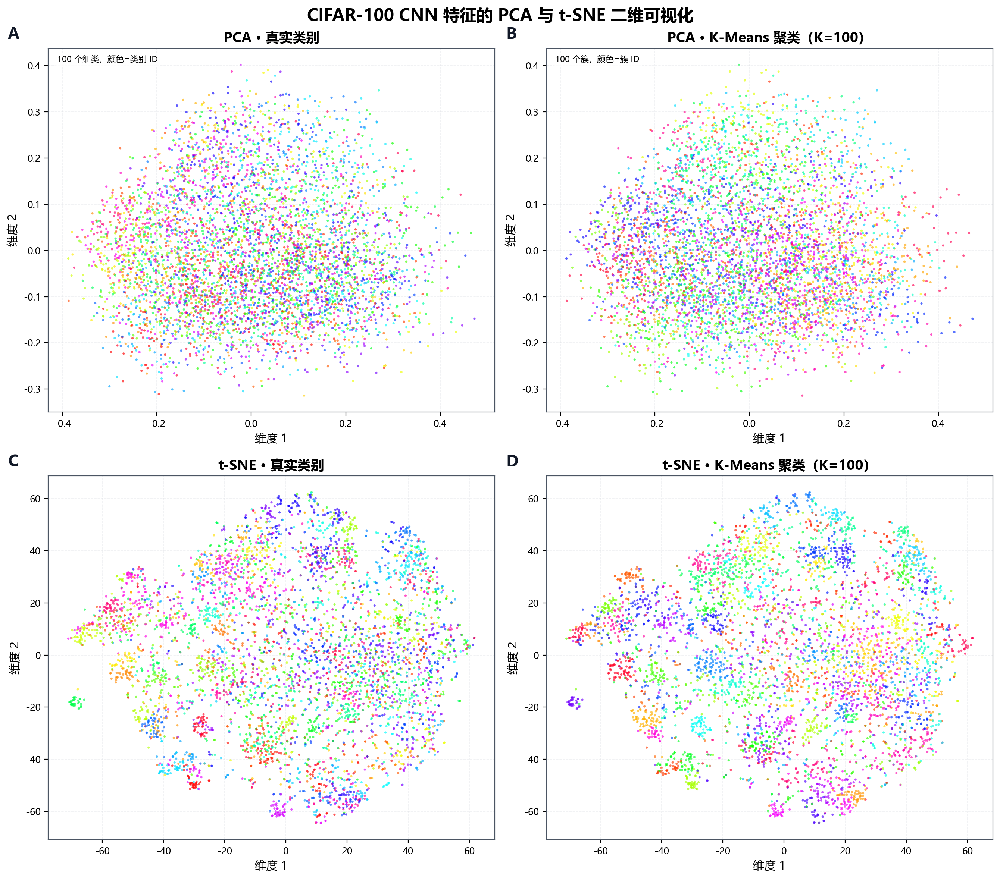
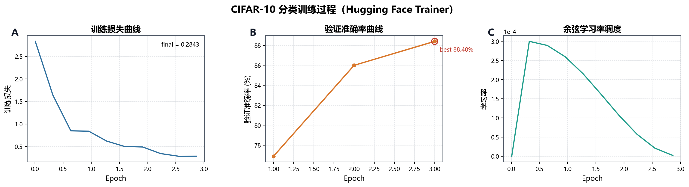
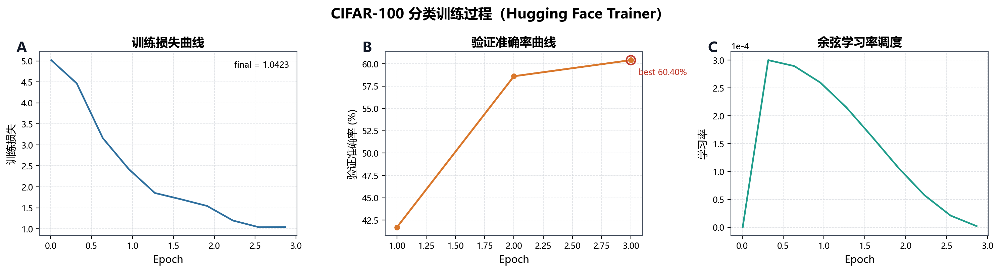

# 基于预训练 CNN 的图像分类与聚类

**Pretrained CNN-based Image Classification and Clustering on CIFAR-10 and CIFAR-100**

使用同一个 ImageNet 预训练 ResNet18 Backbone，在 CIFAR-10 与 CIFAR-100 上分别完成迁移学习分类与 K-Means 聚类，并对两个数据集的分类/聚类难度进行统一对比。


---

## 1. 项目简介

本项目是机器学习课程进阶实验的完整实现，核心目标不是追求 SOTA 精度，而是用**简单、成熟、可复现**的流程说明：

- 一个预训练 CNN Backbone 如何通过更换分类头同时服务两个类别数量不同的数据集；
- 有监督分类特征与无监督 K-Means 聚类之间的联系与差异；
- 类别数量从 10 增加到 100 时，分类与聚类难度如何变化。

**技术路线**：

```
输入图像 32×32
   → 统一预处理（Resize 96×96 + ImageNet 归一化 + 训练增强）
   → 共享 ResNet18 Backbone（ImageNet-1K 预训练）
   → 512 维特征
      ├── CIFAR-10 分类头 Linear(512→10)   → Hugging Face Trainer
      ├── CIFAR-100 分类头 Linear(512→100) → Hugging Face Trainer
      └── K-Means 聚类头 K=10 / K=100      → sklearn MiniBatchKMeans
```

**约束**：分类训练全部由 `transformers.Trainer` 完成，聚类全部由 `sklearn.cluster.MiniBatchKMeans` 完成，没有手写训练循环或 K-Means。



---

## 2. 实验结果速览

### 2.1 分类结果（完整官方测试集 10,000 张）

| 指标 | CIFAR-10 | CIFAR-100 |
|---|---:|---:|
| 测试 Accuracy | **87.54%** | **60.08%** |
| Top-3 Accuracy | 98.02% | 81.40% |
| Top-5 Accuracy | 99.56% | 88.51% |
| Macro F1 | 0.8742 | 0.5949 |
| 随机猜测水平 | 10.00% | 1.00% |

### 2.2 聚类结果（冻结 ImageNet 特征）

| 指标 | CIFAR-10（K=10） | CIFAR-100（K=100） |
|---|---:|---:|
| ARI | **0.3382** | **0.1616** |
| NMI | 0.4796 | 0.4874 |
| Purity | 0.5527 | 0.3074 |
| Silhouette | 0.0379 | 0.0291 |
| MiniBatchKMeans 耗时 | 5.4 s | 55.0 s |

> 补充实验：使用**微调后 Backbone** 的特征做同样的聚类，CIFAR-10 的 ARI/NMI 提升到 **0.7498 / 0.7588**，CIFAR-100 提升到 **0.3316 / 0.6251**。说明为分类优化的特征同样能改善聚类，但类别数增加带来的困难仍然存在。

### 2.3 综合对比图



---

## 3. 图表展示

### 3.1 混淆矩阵

| CIFAR-10 | CIFAR-100 |
|---|---|
|  |  |

CIFAR-10 的错误集中在猫/狗、鹿/马等视觉相似类别；CIFAR-100 的 100×100 混淆矩阵更分散，说明细粒度类别之间更难区分。

### 3.2 特征分布（PCA / t-SNE）

| CIFAR-10 | CIFAR-100 |
|---|---|
|  |  |

### 3.3 训练曲线

| CIFAR-10 | CIFAR-100 |
|---|---|
|  |  |

更多图表（聚类样本展示、单类准确率、Top 混淆对、预处理示例等）见 [`results/figures/`](results/figures)。

---

## 4. 数据集与实验设置

| 项目 | 设置 |
|---|---|
| 数据集 | CIFAR-10 / CIFAR-100（官方 50,000 训练 + 10,000 测试） |
| 训练集 | 每数据集 5,000 张（CIFAR-10 每类 500 张；CIFAR-100 每类 50 张） |
| 验证集 | 每数据集 1,000 张（与训练集索引互斥） |
| 测试集 | **完整 10,000 张，不参与训练/调参** |
| 输入尺寸 | 96×96（Resize；ImageNet 预训练输入为 224） |
| 训练增强 | RandomResizedCrop + HorizontalFlip + ColorJitter |
| 归一化 | ImageNet mean/std：`(0.485,0.456,0.406)` / `(0.229,0.224,0.225)` |
| 分类模型 | ResNet18（ImageNet-1K 预训练）+ 双分类头，约 11.23 M 参数 |
| 训练框架 | Hugging Face `Trainer` |
| 优化器 | AdamW，lr=3e-4，weight decay=0.01 |
| 学习率调度 | Cosine + 10% warmup |
| Epochs / Batch | 3 / 32 |
| 聚类 | `MiniBatchKMeans(n_clusters=K, n_init=10, batch_size=4096, max_iter=500)` |
| 特征 | 冻结 Backbone 的 512 维 GAP 特征，L2 行归一化 |
| 随机种子 | 42 |

> 选择 96×96 是在 CPU 可承受的计算量与预训练感受野之间折中；直接使用 32×32 会使 ResNet18 最终特征图过小，224×224 则会使 CPU 训练时间增加约 5 倍。

---

## 5. 项目结构

```
cnn-classification-clustering/
├── main.ipynb                     # 主实验 Notebook（已执行，含全部输出）
├── README.md
├── requirements.txt
├── LICENSE
├── .gitignore
│
├── src/
│   ├── datasets.py                # 数据加载、分层划分、预处理
│   ├── models.py                  # ResNet18 双头模型
│   ├── training.py                # Trainer 封装与分类指标
│   ├── feature_extraction.py      # CNN 特征提取
│   ├── clustering.py              # MiniBatchKMeans 与聚类指标
│   └── visualization.py           # 统一风格图表
│
├── scripts/
│   └── download_cifar_parquet.py  # 下载并转换 CIFAR 数据
│
├── data/
│   └── README.md                  # 数据未提交，说明下载方式
│
├── checkpoints/
│   ├── README.md                  # 模型权重通过 Release 下载
│   ├── cifar10/training_summary.json
│   └── cifar100/training_summary.json
│
├── results/
│   ├── figures/                   # 18 张实验图表（PNG）
│   ├── metrics/                   # 指标 JSON / CSV
│   ├── features/                  # 聚类结果、簇中心、降维坐标
│   ├── screenshots/               # 16 张实验截图
│   └── logs/                      # Trainer 训练日志
│
├── reports/
│   ├── 实验报告.docx
│   └── 实验报告.pdf
│
├── presentation/
│   └── 基于预训练 CNN 的图像分类与聚类.pptx
│
└── docs/
    └── 实验结果说明.md
```

---

## 6. 快速开始

### 6.1 环境安装

```bash
git clone git@github.com:Incredible-Jian/cnn-classification-clustering.git
cd cnn-classification-clustering

python -m venv .venv
# Windows: .venv\Scripts\activate
# Linux/macOS: source .venv/bin/activate

pip install -r requirements.txt
```

### 6.2 准备数据

仓库不包含 CIFAR 原始数据（约 596 MB），运行以下脚本自动下载并转换为 NPZ：

```bash
python scripts/download_cifar_parquet.py
```

### 6.3 运行实验

```bash
jupyter notebook main.ipynb
```

按顺序运行全部单元格即可。Notebook 会自动：

1. 检查/下载 CIFAR-10 与 CIFAR-100；
2. 分层划分训练/验证集并展示样本；
3. 加载 ImageNet 预训练 ResNet18；
4. 用 Hugging Face Trainer 训练两个分类头；
5. 在完整测试集上计算 Accuracy、混淆矩阵；
6. 提取 CNN 特征并完成 K-Means 聚类；
7. 计算 ARI/NMI、绘制 PCA/t-SNE 与对比图。

也可以无界面执行：

```bash
jupyter nbconvert --to notebook --execute --inplace main.ipynb
```

> 参考运行时间：16 核 CPU 约 **35–45 分钟**（两个数据集各训练 3 epochs，约 10 分钟；特征提取与聚类约 15 分钟；绘图约 5 分钟）。有 GPU 时可适当增大 batch size、输入尺寸与 epoch 数。

---

## 7. 模型权重与训练日志

两个训练好的权重（合计约 90 MB）通过 GitHub Release 提供：

**下载页**：<https://github.com/Incredible-Jian/cnn-classification-clustering/releases/tag/v1.0-weights>

| 文件 | 说明 |
|---|---|
| `resnet18_cifar10.pth` | CIFAR-10 双头模型（10 类头） |
| `resnet18_cifar100.pth` | CIFAR-100 双头模型（100 类头） |

```bash
curl -L -o checkpoints/cifar10/resnet18_cifar10.pth \
  https://github.com/Incredible-Jian/cnn-classification-clustering/releases/download/v1.0-weights/resnet18_cifar10.pth
curl -L -o checkpoints/cifar100/resnet18_cifar100.pth \
  https://github.com/Incredible-Jian/cnn-classification-clustering/releases/download/v1.0-weights/resnet18_cifar100.pth
```

训练过程日志：`results/logs/trainer_cifar10.log`、`results/logs/trainer_cifar100.log`。

---

## 8. 实验报告与汇报 PPT

- [实验报告 PDF](reports/实验报告.pdf)（推荐在线阅读）
- [实验报告 DOCX](reports/实验报告.docx)
- [汇报 PPT](<presentation/基于预训练 CNN 的图像分类与聚类.pptx>)
- [实验结果说明](docs/实验结果说明.md)

报告包含实验目的、原理、数据集、模型结构、训练设置、分类/聚类结果、CIFAR-10 与 CIFAR-100 对比分析及不足。PPT 共 11 页，适合课堂汇报。

---

## 9. 结果文件说明

| 路径 | 内容 |
|---|---|
| `results/metrics/*_test_metrics.json` | 测试集 Accuracy、Top-3/5、Macro F1 等 |
| `results/metrics/*_confusion_matrix.csv` | 混淆矩阵（行=真实类，列=预测类） |
| `results/metrics/*_classification_report.csv` | 每类 precision / recall / F1 |
| `results/metrics/*_clustering.json` | ARI、NMI、Purity、Silhouette、耗时 |
| `results/metrics/comparison.csv` | 两个数据集的综合指标对比 |
| `results/features/*_cluster_assignments.csv` | 10,000 张测试图的聚类标签与到质心距离 |
| `results/features/*_pca2d.npy` / `*_tsne2d.npy` | 5,000 个分层样本的二维坐标 |
| `results/figures/` | 全部高分辨率 PNG 图表 |
| `results/screenshots/` | 数据加载、Trainer 日志、指标结果、图表截图 |

> 大型中间数组（`results/features/*_test_*.npz`、logits/probs `.npy`）未提交，运行 Notebook 会自动重新生成。

---

## 10. 可复现性说明

- 所有随机种子固定为 42（Python / NumPy / PyTorch / Trainer / K-Means）；
- 训练/验证/测试划分完全由 `src/datasets.py` 中的分层抽样函数确定，索引互斥；
- 测试集只用于最终评估与聚类，不参与模型选择；
- 所有指标由 `sklearn.metrics` 计算，图表由保存的 JSON/CSV 重新绘制；
- Notebook 已保留真实执行输出（17 个代码单元全部有输出，无错误），可直接检查实验过程。

---

## 11. English Overview

This repository contains a complete course project on **pretrained CNN-based image classification and clustering**. A single ImageNet-pretrained ResNet18 backbone is shared by two dataset-specific heads (10-way for CIFAR-10 and 100-way for CIFAR-100). Classification is trained end-to-end with the Hugging Face `Trainer`; clustering is performed by scikit-learn `MiniBatchKMeans` on frozen 512-d CNN features (K=10 and K=100).

Key results on the full 10,000-image test sets:

| Task | Metric | CIFAR-10 | CIFAR-100 |
|---|---|---:|---:|
| Classification | Accuracy | 87.54% | 60.08% |
| Clustering (frozen features) | ARI | 0.3382 | 0.1616 |
| Clustering (frozen features) | NMI | 0.4796 | 0.4874 |

The gap between the two datasets illustrates how increasing the number of fine-grained classes makes both supervised classification and unsupervised clustering substantially harder under the same training budget.

---

## 12. 致谢

- CIFAR-10 / CIFAR-100：Krizhevsky, *Learning Multiple Layers of Features from Tiny Images*；
- 预训练模型与数据加载：`torchvision`；
- 分类训练：Hugging Face `transformers`；
- 聚类与指标：`scikit-learn`。

## 13. License

本项目采用 [MIT License](LICENSE)，仅用于学习与研究。
